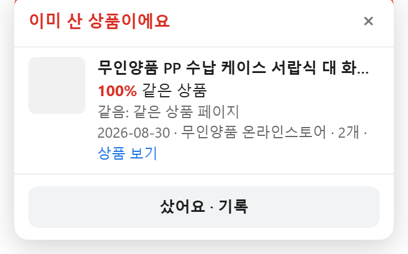
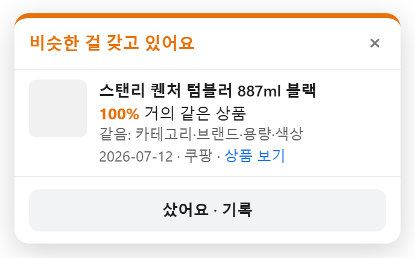
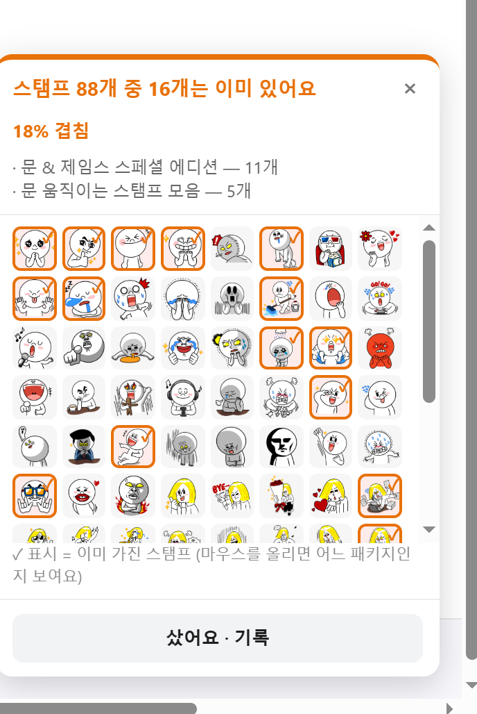

# Ddabulu

[한국어](README.md) · [English](README.en.md) · [日本語](README.ja.md) · **简体中文**

> 那个，家里已经有了。

一款 Chrome 扩展：在商品页面上立即提醒你，**正在看的商品是否和已经拥有的东西重复**。避免同一样东西买两次、不知不觉又买了个差不多的，或者给同一个人送了同样的礼物。

| 已经买过 | 相似商品 | LINE 贴图重复 |
|---|---|---|
|  |  |  |

<sub>截图来自早期版本（韩语界面），与现在的画面略有不同。</sub>

## 主要功能

### 已有物品提醒
- 打开商品页面后，会和你记录的物品进行比较，若有重复，会在页面右下角以卡片提示。
- **同一商品**（相同商品编号或网址）显示为 100%；其他店铺的同一商品或相似商品则显示分数：
  - 90% 以上 **几乎相同** · 70% 以上 **非常相似** · 50% 以上 **同类**
- 分数综合比较分类、商品名、品牌、店铺、容量、颜色、尺码、价格和**商品图片**。点每一项的“detail”可以看到依据和得分。
- 比较方式会随商品种类调整：服装鞋类更看重颜色和尺码，贴图和表情更看重图案。

### LINE 贴图逐张比较
- 打开贴图套装时，会把里面的每一张贴图和你已有套装中的贴图按图案逐一比较。
- 显示“88 张中有 16 张已经有了”、重复比例，以及**价格中有多少是花在重复上的**，并在页面上每张贴图旁标出相似程度。

### 礼物记录
- 用“送了”记录**送给了谁、送了什么**。
- 想再送同一个人同样的东西时会提醒你。送给其他人的不算重复。

### 候选
- 把还没买、正在考虑的商品加入**候选**。可以是给自己的，也可以是“给某某的礼物候选”。
- 每个候选都会显示**是否和已有物品重复**（礼物候选则和那个人已收到的礼物比较），方便挑一个不重复的买。
- 实际买下或送出候选后，会自动从候选移到记录中。

### 不重复的其他选择
- 当你在看会重复的商品时，推荐其他用户一起看过、且**和你的物品不重复**的商品。
- 推荐表整份下载后在**浏览器内**挑选，服务器不会知道你在看什么。（推荐服务即将上线。）

### 其他
- **分享：** 把物品和礼物清单或提醒卡片生成图片，复制或保存。
- **导出与导入：** 用 JSON 文件备份或迁移记录，可按日期、自己的或礼物筛选。
- **暂停提醒：** 可以在几天内或在指定网站上关闭提醒。
- **四种语言：** 韩语、英语、日语、简体中文。跟随浏览器或手动选择。

## 支持的店铺

有专门规则的店铺：

| 店铺 | 说明 |
|---|---|
| LINE STORE | 贴图（逐张按图案比较）、表情 |
| Kakao 表情商店 | 韩国 |
| Coupang · Naver 智能商店/品牌商店 · 11街 · Gmarket · MUSINSA | 韩国 |
| Amazon | 各国站点 |

此外，只要页面提供商品信息（schema.org `Product` 或 `og:type=product`），大多数店铺都能使用。

## 安装

- **Chrome 应用商店：** 即将上架。
- **从源码安装：**
  1. 下载本仓库（`Code → Download ZIP` 或 `git clone`）。
  2. 在 Chrome 中打开 `chrome://extensions`，打开右上角的**开发者模式**。
  3. 点击**加载已解压的扩展程序**，选择 `extension/` 文件夹。

## 隐私

- 购买记录、收礼人、候选和备注**只保存在你的浏览器里**（`chrome.storage.local`），不会发送到服务器。
- 首次安装时会询问是否发送**匿名使用统计**。不同意也能使用全部功能，随时可以在设置中更改。
- 统计中不包含网址、你的物品清单、收礼人姓名，也没有固定的用户 ID。所有可能发送的字段都定义在 [`extension/lib/telemetry.js`](extension/lib/telemetry.js) 这一个文件里，设置页面可以看到待发送的原始数据。
- 详情：[隐私政策](docs/PRIVACY.md)（韩语）

## 开发

```
extension/
  manifest.json        扩展配置
  background.js        记录保存、比较、图片哈希、统计队列
  content.js           购物页面上的提醒卡片
  popup.html/js/css    工具栏弹窗（记录、清单、设置、同意）
  lib/extract.js       从页面读取商品信息
  lib/similarity.js    商品比较与评分
  lib/bundle.js        LINE 贴图图案比较
  lib/recs.js          挑选不重复的推荐
  lib/telemetry.js     全部匿名统计字段与同意处理
  lib/i18n.js          韩、中、日、英文案
  lib/share.js         用于分享的清单图片
  tests/               测试
```

测试（Node 22 及以上，无需额外安装）：

```sh
node --test extension/tests/*.cjs
```

欢迎在 [Issues](https://github.com/YangJongWon/ddabulu/issues) 提交问题和建议。

## 许可证

代码以 [MIT 许可证](LICENSE)发布。

**Ddabulu 名称、标志和图标不在 MIT 许可证范围内。** 如果发布修改版本，请使用其他名称和图标。
